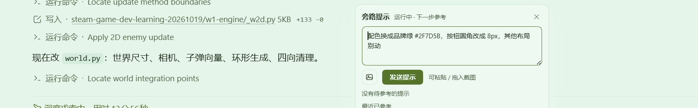

# dsh-szg-hint

English | [中文](README.md)

A sidecar hint plugin: drop a line into a running task and the agent picks it up at its **next step** — without interrupting the task and without polluting the chat history.
Since **0.2.0**, a hint can also carry images: paste a screenshot, drop files, or pick them from disk, and they travel into the next step with the hint.

Version **0.2.0**. Requires dsh **>= 0.2.0-rc.2** — image hints rely on the host's attachment service.
**Older hosts are unverified**: 0.2.0 uses the v4 `plugin:` message-source namespace, and whether an older host
accepts it has not been tested — try it in a scratch profile before upgrading.

The user drops a line while a task is running; the agent picks it up at its **next step**. The task is not interrupted and the main chat history stays clean.
A hint appears in exactly one step's request and is then marked as consumed (the UI receives a receipt).

Difference from the built-in `Agent.steer()` / `Agent.inject()`: messages sent through those channels enter the session history (see `agent/inbox/claimed`). This plugin injects through `agent/pre-step`, appending only to **the current step's** request and never calling `session.append` — so the hint is absent from the chat area after a page refresh, and the model sees it exactly once.


While a task is running, a hint does not interrupt it — the model picks it up at its **next step** and carries on:



## Let an agent install it for you

If you would rather not type commands, hand your coding agent the repository URL plus this block:

```text
Install dsh-szg-hint into my local dsh web profile:
1. Check the environment first: dsh >= 0.2.0-rc.2 and Node ^22.19 or >=24. Stop and tell me if either is missing.
2. Install: dsh plugin --profile web add github:skyyyyyk/dsh-szg-hint
   - If pnpm >= 10 rejects the build script, allow the exact package key it prints, then retry.
   - If that still fails, git clone into a temp dir and run dsh plugin --profile web add <that dir>.
3. Verify: dsh --profile web --dump-config | grep dsh-szg-hint must show the plugin line.
4. Restart dsh web (that process only; do not change the port).
5. Open a conversation and confirm there is a lightbulb button at the right of the composer tool row.
   If there is none, paste the dump-config output and any host log lines starting with [dsh-szg-hint].

Do not change any other settings. When done, report: the installed commit, the verify output, and whether the restart succeeded.
```

Once installed you can simply tell the agent: "send a sidecar hint to the running task: use the brand green for the accent".

## Installation

```sh
# from npm (after release)
dsh plugin --profile web add dsh-szg-hint

# from GitHub source (pnpm ≥10 asks you to allow build scripts; the first add fails with the exact package key)
dsh plugin --profile web add github:skyyyyyk/dsh-szg-hint

# from a local checkout
dsh plugin --profile web add /path/to/dsh-szg-hint
```

Restart `dsh web` afterwards. To check only whether the layer is recognized, run
`dsh --profile web --dump-config | grep dsh-szg-hint`.

## Halves and responsibilities

| Half | Responsibility |
|---|---|
| Host (`src/index.ts` + `src/store.ts` + `src/protocol.ts` + `src/images.ts`) | Queue (JSONL on disk), data-plane routes `/dsh-szg-hint/*` (including image reads), `agent/pre-step` injection (with image blocks), run-state subscription (`turn/start` / `turn/end`), image admission and rendering, the `hint_send` / `hint_status` tools |
| Client (`src/client/`) | `./link.ts`, a single host link (SSE + fallback polling + writes); `./image-prep.ts`, local downscaling; `HintBar.tsx`, a compact entry at the right of the tool row (`conversation.input.right`, a 28px round button with a pop-up panel) — pending counter badge, input panel (Enter sends, Shift+Enter inserts a newline), **paste/drop/pick attachments with thumbnails and a full-size preview**, pending list with cancel, recently consumed hints, and a toast in the top-right corner |

Both halves share the type contract in `src/protocol.ts` (types only, no runtime code).

Data lands in `$DSH_HOME/dsh-szg-hint/hints.jsonl` — an append-only event stream with two states, `put` and `del`; replaying it at startup yields the current state, and beyond 2000 lines it is compacted to "pending + the 20 most recently consumed". Persisting `consumed` is what makes a **restart not re-consume**: hints the model has already seen are never pushed a second time. **Images are not stored in this file** — the queue keeps attachment references only (see below).

## Data channels

| Channel | Purpose | Behavior |
|---|---|---|
| `GET /dsh-szg-hint/events` (SSE) | Main channel | Every state change pushes one `event: state` frame (a full snapshot carrying `revision` and `imageLimits`); actions push one `event: hint` frame (`added` / `consumed` / `cancelled`, with `imageCount`, driving the toast); opening the stream writes a comment line and `retry` first, then a `: ping` every 25 seconds. Zero traffic when idle |
| `GET /dsh-szg-hint/state` | Polling fallback | Returns **the same** snapshot, used when SSE is unavailable (older host, proxy interference); every 4 seconds, backing off to 12 seconds after consecutive failures |
| `POST /dsh-szg-hint` | Enqueue | Passes the trust fence first (see below); body `{ text, sessionId?, images? }` (`sessionId` omitted means global; `images` is `[{ mediaType, data(base64), name? }]`, and `data` carries no `data:` prefix); returns `{ ok, hintId, running, dropped, maxContentChars, imageCount }`, where `running` reports whether that session is running a turn right now — the UI picks its wording from it. **Text and images must not both be empty** (an image-only hint is valid). The body cap is `maxTotalImageBytes × 4/3` (base64 expansion) `+ 64 KiB` |
| `DELETE /dsh-szg-hint` (body `{ id }`) | Cancel | Pending hints can be cancelled; an already-consumed hint returns 409 and an unknown one 404 (Chinese reason text, shown as-is by the UI). `DELETE /dsh-szg-hint/<id>` is the same action in path form, convenient for curl |
| `GET /dsh-szg-hint/image/<hint id>/<index>` | Image read | Returns the bytes of image n of that hint (index starts at **0**; `content-type` + `content-length` + `etag` + `private, max-age=31536000, immutable`, GET/HEAD supported). It deliberately **does not expose attachmentId**: otherwise this route would become a generic "read the attachment store by content hash" endpoint. As it stands it can only serve images that belong to a hint still in the queue, and cancelling the hint makes it 404 immediately |

The snapshot describes image capability through `imageLimits`:
`{ enabled, maxImages, maxImageBytes, maxTotalBytes, mediaTypes }`. The UI reads those numbers and keeps no second copy of its own.

The browser half has a single application path (`normalizeSnapshot` plus state replacement) — pushed and polled snapshots are indistinguishable to the component.
Action frames only drive the toast (deduplicated by "action + hint id", so an SSE replay does not re-toast). The whole link disconnects while the page is hidden, so it never occupies the browser's per-origin connection budget.

## Image hints (new in 0.2.0)

Four stages, each with a single owner:

| Stage | Where | What happens |
|---|---|---|
| Upload | Browser, `image-prep.ts` | Only png / jpeg / webp / gif are accepted. Decode to get dimensions → if already within limits and the longest edge is ≤ 2048, send **as-is**; otherwise re-encode on a canvas (longest edge 1600; a PNG source stays PNG first, then falls back through a JPEG quality ladder of 0.9 / 0.78 / 0.62, and finally to 1024 if still too large). GIFs are never re-encoded (a canvas would flatten animation to a still frame); an oversized GIF is rejected so the user can pick another |
| Store | Host, `ctx.attachments.saveImages` | The attachment service performs **authoritative** validation (decode, media-type check, pixel/byte caps, normalized re-encode) and returns content-addressed, immutable references (`attachmentId` = sha256). **All-or-nothing** per batch: on failure not a single byte reaches the queue |
| Inject | Host, `agent/pre-step` | References become `{ type: 'image', attachment }` content blocks in the same plugin message as the text; the text lists each image as "附图 k: name (size, type, bytes)", where k matches the order of the image blocks that follow |
| Display | Host image route + UI | The pending list renders thumbnails (local preview via object URL, no round trip; pending items via the host route), and clicking one opens a larger preview |

**Limits** (override through cordis config; the UI reads the same numbers from the snapshot's `imageLimits`):

| Key | Default | Accepted range | Description |
|---|---|---|---|
| `maxImagesPerHint` | `3` | 1 – 10 | Maximum images per hint |
| `maxImageBytes` | `4 MiB` | 64 KiB – 64 MiB | Encoded byte cap for a single image (the UI compresses down to this line first) |
| `maxTotalImageBytes` | `12 MiB` | 64 KiB – 128 MiB | Combined cap for one hint (also the input to the POST body cap: `total × 4/3 + 64 KiB`) |

Out-of-range values are clamped to these intervals rather than letting the plugin start with an unusable limit.

**Capability fallback**: if the model on this step's route cannot take images (`inputModalities` has no `image`), the core projects images to an `[image omitted …]` placeholder — the model knows an image exists but cannot see it. So, **only when this step actually carries images**, the plugin asks `ctx.llm.resolveModelInfo` once; if it is *definitively* told "no images", it appends the path of a local read-only copy to the hint text:
`；本步模型不接受图片输入，请用 vision_analyze / read_image 读这个只读副本：<path>`.
If the answer is unknown (service absent, route not resolvable), the plugin assumes images work: adding the path would only add noise to the normal path.
The path comes from the attachment service's `imageHostPath`; when that returns `undefined`, no path is written, and whether the model sees the image depends on the route itself — non-file attachment backends are unverified.

**Degradation**: `attachments` is a **soft dependency** (not in `inject`; obtained via `ctx.get('attachments')`). When the host does not provide it, the snapshot reports `imageLimits.enabled = false`, the UI disables the attachment entry (the panel says "纯文字（宿主无附件服务）"), and the backend rejects image-bearing requests (text-only hints are entirely unaffected). If the service mounts **after** the plugin, the next request, step, or tool call notices it and enables image capability in place — **no restart needed**.

**Security**: the image route passes the host's connection trust fence like every other data-plane path (401/403 are refused with the original status), and it serves strictly by "hint id + index"; the cache headers are `private` (authenticated reads only, no intermediary caching) and `immutable` (the reference is a sha256, so the bytes never change for a given id), with `etag` and `nosniff`.

## Interface (0.2.0 redesign)

- **Entry**: `conversation.input.right` — a 28px round icon button at the right of the tool row (same size as the `+` control on the left of the composer), with a pending counter badge (`99+` beyond 99). Clicking opens a panel upwards.
- **Input**: Enter sends, Shift+Enter inserts a newline. An image-only hint shows as "（图片提示）" in the list.
- **Attachments**: three entry points — paste (Ctrl+V after a screenshot, the common case), drop files onto the panel, or pick files. Thumbnails carry a "压" mark when locally re-encoded and a size/dimension tooltip, and can be removed one by one. Clicking a thumbnail opens a full-size preview; Esc closes the preview first and the panel on the next press.
- **Recently consumed**: shows only a `图N` count tag, no thumbnails — historical entries are not worth another byte fetch.
- **Panel positioning**: the panel shifts horizontally to fit the intersection of the nearest overflow-clipping ancestor and the viewport, so a narrow window or a button near the left edge no longer clips half of it.
- **Icon convention**: the trigger and the attachment entry use **inline SVG** (`viewBox="0 0 16 16"`, `currentColor` strokes), and the close button uses the `✕` glyph; do not use emoji as icons — when the local font lacks a color glyph, an emoji renders as a grey box. New icons should follow this convention.
- **Toasts**: top-right, deduplicated by "action + hint id", so an SSE replay does not re-toast.

## Injection semantics

- Extension point: the `agent/pre-step` waterfall — the same hook the memory plugin's per-turn section uses (after system-prompt assembly, before the model request) — but it **checks on every step**: the user may drop a hint at any moment while a task runs, and the next step should see it whether that is step 2 or step 20.
- Injection form: a user message with source `plugin:dsh-szg-hint` (`form: snapshot`, section name "旁路提示"), appended to this step's message sequence; **it is not written to the chat history** and appears in this step only. With images, the content is "one text block + N image blocks".
- Ownership: taken from the session in the pre-step payload (`payload.agent.session`); hints for that session and global ones (`sessionId = ''`) are consumed oldest-first, at most 20 per step. When the session id is unavailable, **only global hints are taken** — "I cannot tell whose hint this is" does not mean "I may feed another session's hints here".
- Atomicity: taking a hint marks it `consumed` in one synchronous stretch (no `await` in between, the equivalent of a transaction's SELECT+UPDATE on the source side); if building the injected message fails, the hint is **rolled back to pending** and retried on the next step — "marked consumed but the model never saw it" cannot happen.
- Receipt: a successful injection pushes a `hint` frame (`kind: consumed`, with `imageCount`) and the UI toasts "AI 已参考你的提示（含 N 张图）".

## Model Experience

- **What the model sees**: one user-role message whose body looks like

  ```text
  📌 旁路提示（用户在任务执行过程中插入，不占对话历史，仅本条可见）
  请在本步参考下面的要求，然后继续原来的任务；不要停下来等待确认，也不要把它当作新的用户回合。
  1. 照这张参考图把配色改了
     附图 1：ref.png（1600x900，image/png，312 KB）
  ```

  A body longer than 600 characters is truncated for display (the queue keeps the full text, up to 2000).
  An **image-only hint** (no typed text) renders as "（无文字说明，见附图）" instead of an empty bubble.
  The injected wording itself is hardcoded Chinese.
- **Token cost**: one extra message in the steps that have a hint (an empty queue injects nothing at all, so there is no per-step cache churn). Hints arriving together are merged into a single message, at most 20. Images are billed by pixels, which is why the UI caps the longest edge at 1600 and the host-side attachment service compresses again to the route's budget.
- **KV cache**: with an empty pending queue the plugin has **zero effect** on the request; with hints, that step's message sequence gains one tail entry, and later steps return to the original sequence (a hint never appears twice).
- **Actions available to the model**: `hint_send` (deliver a hint to a session, defaulting to its own, optionally with local image paths) and `hint_status` (inspect pending and recently consumed hints, with image counts and image capability).

## Tools (model side)

| Tool | Purpose |
|---|---|
| `hint_send` | Deliver a hint to a session (`sessionId` omitted means the current one): `{ text, sessionId?, images? }`. `images` is an array of local image paths (png / jpg / jpeg / webp / gif); the host reads the files, stores them through the attachment service, and sends them with the hint on the next step. Returns the id, whether it takes effect immediately, and whether the oldest hint was evicted to respect the backlog cap |
| `hint_status` | Inspect the queue: `{ sessionId? }` (omitted means the current session, `*` means all sessions). Returns pending entries with image counts, whether that session is running, image capability and limits, and recently consumed hints |

## Configuration

| Key | Default | Description |
|---|---|---|
| `enabled` | `true` | When off, routes, tools and event subscriptions are not registered |
| `dshHome` | `''` | Empty takes `DSH_HOME`, falling back to `~/.dsh` |
| `maxPerStep` | `20` | Maximum hints consumed per step (matches the source side; keeps a backlog from blowing up the context) |
| `maxContentChars` | `2000` | Maximum body length (code points; anything longer is truncated) |
| `maxPendingPerSession` | `20` | Pending cap per session; exceeding it evicts the oldest hint and reports it in the write response |
| `keepConsumed` | `20` | Recently consumed hints kept in the snapshot (also the number kept when compacting) |
| `heartbeatMs` | `25000` | SSE comment heartbeat interval |
| `maxImagesPerHint` | `3` | Maximum images per hint (clamped to 1 – 10) |
| `maxImageBytes` | `4 MiB` | Per-image byte cap (clamped to 64 KiB – 64 MiB) |
| `maxTotalImageBytes` | `12 MiB` | Combined per-hint byte cap (clamped to 64 KiB – 128 MiB) |

## Building and rebuilding

The package ships its own `cordis.patch.yml` (one `insert` row with `id: dsh-szg-hint`), which `dsh plugin add` registers as a bundle layer of the profile. **New entries are not picked up by patchReload; restart `dsh web`.**

The build chain is self-contained: `tsdown.config.ts` inherits no host-repository build preset, and CSS Modules are handled by the in-repo lightningcss plugin. Artifacts and their contracts stay inside this repository.

```sh
pnpm install
pnpm run build       # tsdown + tsc: lib/index.js (host), lib/client.js (browser), lib/types/**
pnpm run typecheck   # tsc --noEmit (host and client together)
```

- Changing `src/client/` rebuilds `lib/client.js`, which hot-updates by content hash — no host restart needed.
- Changing `src/index.ts` / `src/store.ts` / `src/images.ts` (the host half) **requires restarting the dsh host**.
- The host loads the artifact pointed to by `exports["."].default` in `package.json`; run `pnpm run build` before trying a real host.

## Tests

| Case | Coverage | Command |
|---|---|---|
| `tests/store.spec.ts` | Queue contract: atomic consumption without duplicates, oldest-first with a per-step cap, session and global scope, global-only when the session is unknown, the three cancel outcomes, rollback when injection fails, the per-session cap with `dropped` reporting, blank rejection and truncation, the run-state signal, no re-consume after restart, bad-line skipping, snapshot semantics; **images**: references travel with the item, image-only hints are valid, image lookup by id+index, references survive restart, old logs and bad fields replay as "no images", recent entries keep only a count, default `imageLimits` shape | `pnpm test` |
| `tests/images.spec.ts` | Pure functions: host admission (whitelist / count / per-image / total / non-canonical base64 / empty data / attachment service absent), extension → media type, byte and image-description text, browser scaling (including extreme aspect ratios that must not collapse to zero) | `pnpm test` |
| `tests/behavior.spec.ts` | End-to-end behavior (real HTTP routes + real `agent/pre-step` calls, loading the build artifact): snapshot shape, enqueue visibility, blank and cross-site rejection, injection and marking, session isolation, three cancel outcomes, rollback when a downstream hook rejects the step, concurrent takes without duplicates, backlog cap and truncation, restart recovery, bad-line tolerance, receipt ownership; **images**: image enqueue and read, the three limit gates, image-only hints, text plus image blocks in injection, image-only injection wording, host-path fallback for text-only routes, degradation when the attachment service is absent, late-mount auto-enable, `hint_send` with local paths; the trust fence (including image reads being refused) | `pnpm test` |
| `tests/attachment-live.spec.ts` | **Real attachment service** (`@deepseek-ai/dsh-attachment-local` + sharp) integration: `saveImages` accepts input (including Chinese names), reference shape matches the `HintImageRef` stored in the queue, `readImage` returns the bytes, `imageHostPath` points at a readable file, the same image yields the same id (content addressing), and bad bytes or oversized images are rejected; the whole block is skipped when `@deepseek-ai/cordis`, the attachment service or sharp is missing | `pnpm test` |
| `tests/host-runtime-probe.mjs` | Host wiring: importable as ESM, export contract (name / inject / Config / apply), route prefix, both tools, both subscription kinds, everything registered through `ctx.effect`, data directory free of private paths | `pnpm run test:probe` |
| `tests/artifact-check.mjs` | Build-artifact contract check: syntax and exports of both halves, route prefix, externalized dependencies, inlined CSS, same-origin client paths, existence of every entry declared in `package.json`, and **bilingual README cross-links plus blob hashes matching `README.i18n.yaml`** | `pnpm run test:artifact` |

`tests/fake-attachments.ts` is an in-memory attachment-service double (not a test file), used by the `behavior` cases so the image path runs without sharp; `attachment-live` reuses its `tinyPng`. `behavior` and `artifact` read the `lib/` artifacts: `pnpm test` runs `pnpm run build` first; build before invoking `vitest` / `probe` directly (without the artifact, `behavior` skips as a whole).

## Trust fence (origin validation on the data plane)

Every data-plane path (`state` / `events` / `POST` / `DELETE` / `image`) passes the host's connection trust fence before dispatch: it reads `connection`'s `requestRejection(req)` and refuses with the original status code — `403` (untrusted host) or `401` (unauthenticated browser) — so only an authenticated page (one carrying the signed session cookie) is let through.

**Why same-origin checking is not enough**: `sameOrigin` inspects only browser cross-site requests that carry a foreign `Origin` header. A local process that sends no `Origin` (a script, another application) is let straight through — so any program on the machine could read the user's hint text and its session, or POST a hint; and a hint enters a running task as a plugin message, which amounts to arbitrary instruction injection. Origin validation has to live on the server.

- `connection` is a **hard dependency** (declared in `inject`) but is read structurally (`Reflect.get`) to avoid a cross-package type dependency; when the service is unavailable, every request answers `503` with a note on stderr rather than being silently allowed.
- The browser half needs no change: same-origin requests carry the cookie, so SSE, polling, writes and image reads all pass.
- Deployed standalone on a host without the `connection` service, authentication must be supplied at the gateway; otherwise the data plane is unusable (503).

## Known Limitations and Deferred Work

- **UI copy is hardcoded Chinese**: the interface language does not follow the host locale, and so is the prompt text injected for the model. Supporting more languages means extracting all of it into locales (the same standing state as the other szg plugins).
- **Without the attachment service only text works**: the image entry is disabled and image-bearing requests are rejected. A host with no attachment service at all cannot do image hints, and this plugin cannot add that capability. If the service mounts late, it enables on the next request (or step / tool call) without a restart.
- **Image lifecycle**: cancelling a hint makes the image route 404 immediately, but the attachment object stays in the attachment store (content-addressed, immutable) — there is no refcount and no reclamation. This is deliberate: the attachment store is global, reclamation belongs to it, and this plugin should not delete from it.
- **Frontend compression is best-effort**: in edge cases (very large animated images, extreme aspect ratios) it rejects and asks the user to crop first; the authoritative validation always lives in the host (`parseImageUploads` + the attachment service), and the frontend only makes the common cases go through.
- **The fallback path is not available on every attachment backend**: the "local read-only copy" in text-only routes comes from `imageHostPath`; when it returns `undefined`, no path is written (non-file backends are unverified).
- **Images in one hint are not reused across steps**: the same image appears once in a hint; referencing it across several steps means sending it again (by design: a hint is a one-shot sidecar, not a session attachment).
- **Hints do not enter the chat history**: they are invisible in the chat area after a refresh; pending and recently-consumed hints come from the snapshot (not kept in client history). Recently consumed entries show only the image **count** (`图N`), not thumbnails.
- **Run state comes from `turn/start` / `turn/end`**: after a host restart the in-memory "running" set is empty, so `running` is false until the first turn event (the wording degrades to "picked up by the next task", and the hint is still queued as usual).
- **With several sessions in parallel** the SSE stream pushes a global snapshot and each client filters to its own session; action frames from other sessions (a hint sent from another tab) do not toast in this tab.

## License

MIT (see `LICENSE`). The plugin extends the host through dsh's plugin protocol and changes no upstream source; host upgrades are bounded by the public contracts of `agent/pre-step` and `ctx.tools` / `webServer` / `attachments`.
