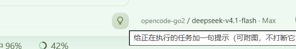
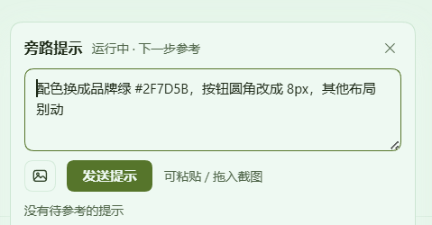

# dsh-szg-hint

[English](README.en.md) | 中文

旁路提示插件：任务执行中插一句话，AI **下一步**即刻参考——**不打断任务、不污染对话历史**。
0.2.0 起支持**附图**：粘贴截图、拖入或点选图片，图随提示一起进入下一步。

当前版本 **0.2.0**，要求 dsh **>= 0.2.0-rc.2**（图片提示依赖宿主的附件服务；**更老的宿主未验证**——
0.2.0 的消息来源用 v4 的 `plugin:` 命名空间，老宿主是否接受未实测，升级前请先在测试 profile 里验证）。

用户在一次任务执行的过程中插一句话，AI **下一步**就参考到，任务不被打断、主对话历史不被污染。
提示只随某一步请求出现一次，随后标记为已参考（前端收到回执）。

与官方 `Agent.steer()` / `Agent.inject()` 的区别：那两条通道的消息会进入会话历史（见
`agent/inbox/claimed`），本插件的注入走 `agent/pre-step` 只追加进**当前这一步**的请求，
不调 `session.append`——所以刷新页面后聊天区看不到它，模型也只看到一次。




任务跑着的时候，面板里的提示不会打断它——模型在**下一步**看到，然后接着干。

## 让智能体自己装（推荐）

不想敲命令的话，把仓库地址和下面这段一起丢给你的编码智能体，它就能自己装好并验证：

```text
请把 dsh-szg-hint 装进本机 dsh 的 web profile：
1. 先检查环境：dsh >= 0.2.0-rc.2，Node ^22.19 或 >=24；不满足就停下来告诉我。
2. 安装：dsh plugin --profile web add github:skyyyyyk/dsh-szg-hint
   - 若 pnpm >= 10 因构建脚本被拒而失败，按它给出的包键授权后重试；
   - 仍失败就 git clone 到临时目录，再 dsh plugin --profile web add <该目录>。
3. 验证：dsh --profile web --dump-config | grep dsh-szg-hint 必须能看到插件行。
4. 重启 dsh web（只重启这一个进程，不要改端口）。
5. 打开对话页，确认输入框工具行右侧有灯泡按钮；没有就把 dump-config 结果和宿主日志里
   [dsh-szg-hint] 开头的行贴给我。

不要改动其它配置。完成后报告：装的 commit、验证命令输出、是否重启成功。
```

装好后可以直接对智能体说：「给正在跑的任务发一条旁路提示：配色改成品牌绿」。

## 安装

```sh
# 从 npm
dsh plugin --profile web add dsh-szg-hint

# 从 GitHub 源码（pnpm ≥10 需按提示授权构建脚本，首次 add 会失败并给出确切包键）
dsh plugin --profile web add github:skyyyyyk/dsh-szg-hint

# 本地 checkout
dsh plugin --profile web add /path/to/dsh-szg-hint
```

装完重启 `dsh web`。只想先验证层是否被识别，用
`dsh --profile web --dump-config | grep dsh-szg-hint`。

## 半边职责

| 半边 | 职责 |
|---|---|
| Host（`src/index.ts` + `src/store.ts` + `src/protocol.ts` + `src/images.ts`） | 队列（JSONL 落盘）、数据面路由 `/dsh-szg-hint/*`（含取图）、`agent/pre-step` 注入（带 image 块）、运行态订阅（`turn/start` / `turn/end`）、图片准入与渲染、`hint_send` / `hint_status` 工具 |
| Client（`src/client/`） | `./link.ts` 一条宿主链路（SSE + 降级轮询 + 写操作），`./image-prep.ts` 本地压缩，`HintBar.tsx` 工具行右侧的紧凑入口（`conversation.input.right`，28px 圆钮 + 上弹面板）：待参考计数角标、输入面板（Enter 发送 / Shift+Enter 换行）、**粘贴/拖放/点选附图 + 缩略图 + 放大预览**、待参考列表与撤销、最近已参考、右上角轻提示 |

两侧共用 `src/protocol.ts` 的类型契约（只有类型，没有运行时代码）。

数据落 `$DSH_HOME/dsh-szg-hint/hints.jsonl`（append-only 事件流：`put` / `del` 两态，启动回放即得当前
状态；行数超过 2000 自动压缩成「待消费 + 最近 20 条已消费」）。`consumed` 落盘的意义是**重启不重复
消费**：模型已经看过的提示不会再灌一遍。**图片不在这个文件里**——队列只存附件引用（见下）。

## 数据通道

| 通道 | 用途 | 行为 |
|---|---|---|
| `GET /dsh-szg-hint/events`（SSE） | 主通道 | 状态一变推一帧 `event: state`（完整快照，含 `revision` 与 `imageLimits`）；动作推一帧 `event: hint`（`added` / `consumed` / `cancelled`，带 `imageCount`，供轻提示）；开通道先写注释行与 `retry`，之后每 25 秒一条 `: ping`。空闲时零流量 |
| `GET /dsh-szg-hint/state` | 轮询兜底 | 返回**同一个**快照，供 SSE 不可用（老宿主 / 代理干扰）时降级；4 秒一次，连续失败降频到 12 秒 |
| `POST /dsh-szg-hint` | 入队 | 先过信任围栏（见下节）；body `{ text, sessionId?, images? }`（`sessionId` 留空 = 全局；`images` 是 `[{ mediaType, data(base64), name? }]`，`data` 不含 `data:` 前缀）；返回 `{ ok, hintId, running, dropped, maxContentChars, imageCount }`；`running` 说明「该会话此刻是否在跑回合」，前端据此选文案。**正文与附图至少要有一样**（纯图提示合法）。body 上限按「合计图片上限 × 4/3（base64 膨胀）+ 64 KiB」计算 |
| `DELETE /dsh-szg-hint`（body `{ id }`）| 撤销 | 待参考可撤；已被参考返回 409、不存在返回 404（中文原因，前端直接展示）。`DELETE /dsh-szg-hint/<id>` 是同一动作的路径形式，方便 curl |
| `GET /dsh-szg-hint/image/<提示 id>/<序号>` | 取图 | 回吐该条提示第 n 张图的字节（序号从 **0** 开始；`content-type` + `content-length` + `etag` + `private, max-age=31536000, immutable` 长缓存，支持 GET/HEAD）。**刻意不按 attachmentId 暴露**：否则这条路由就成了「按内容哈希读附件库」的通用出口；现在它只能读到队列里某条提示自己带的图，提示一撤销立刻 404 |

快照里的图片能力用 `imageLimits` 描述：`{ enabled, maxImages, maxImageBytes, maxTotalBytes, mediaTypes }`。
前端只认这一份数字，不在本地另写一套。

浏览器半边只有一条应用路径（`normalizeSnapshot` + 状态替换），「推来的」与「拉来的」在组件看来完全一样；
动作帧只用于弹轻提示（按「动作 + 提示 id」去重，SSE 重放不会重复弹）。页面不可见时整条链路断开（不占浏览器每源连接配额）。

## 图片提示（0.2.0 新增）

四段链路各归其位，谁也不越界：

| 段 | 在哪 | 做什么 |
|---|---|---|
| 上行 | 浏览器 `image-prep.ts` | 只收 png / jpeg / webp / gif。解码取尺寸 → 已在限额内且最长边 ≤ 2048 就**原样上行**；否则画布重编码（最长边 1600，PNG 源优先仍用 PNG，超限退 JPEG 质量阶梯 0.9 / 0.78 / 0.62，仍超限缩到 1024 再试）。GIF 不重编码（canvas 会把动图压成静帧），超限直接报错让用户换一张 |
| 入库 | 宿主 `ctx.attachments.saveImages` | 附件服务做**权威**校验（解码、媒体类型核对、像素/字节上限、归一化重编码）并返回内容寻址的不可变引用（`attachmentId` = sha256）。**整批**语义：要么全成、要么全不成——失败时队列一个字都不写 |
| 注入 | 宿主 `agent/pre-step` | 引用还原成 `{ type: 'image', attachment }` 内容块，与正文同一条 plugin 消息进本步请求；正文里按「附图 k：名字（尺寸、类型、大小）」列出，k 与后面的 image 块顺序一一对应 |
| 回显 | 宿主取图路由 + 前端 | 待参考列表画缩略图（本地预览走 object URL，零往返；待参考列表走宿主路由），点开可放大 |

**限额**（可用 cordis 配置覆盖，前端从快照的 `imageLimits` 读同一份数字）：

| 键 | 默认 | 可设范围 | 说明 |
|---|---|---|---|
| `maxImagesPerHint` | `3` | 1 ~ 10 | 单条提示最多几张图 |
| `maxImageBytes` | `4 MiB` | 64 KiB ~ 64 MiB | 单张图的编码字节上限（前端会先压到这条线内） |
| `maxTotalImageBytes` | `12 MiB` | 64 KiB ~ 128 MiB | 单条提示所有图的合计上限（也是 POST body 上限的算法输入：`合计 × 4/3 + 64 KiB`） |

超出范围的配置值会被夹到上述区间，而不是让插件带着一个不可用的限额启动。

**能力兜底**：若本步路由的模型不吃图（`inputModalities` 不含 `image`），核心会把图片投影成
`[image omitted …]` 占位文字——模型知道有图却看不到。所以插件在**本步真的带图时**问一次
`ctx.llm.resolveModelInfo`，**明确**问出「看不到」时把本机只读副本路径写进正文：
`；本步模型不接受图片输入，请用 vision_analyze / read_image 读这个只读副本：<路径>`。
问不出来（服务缺席 / 路由解析失败）时按「能看」处理：加路径反而会给正常路径添噪音。
路径由附件服务的 `imageHostPath` 提供；拿不到（返回 `undefined`）时不写路径，此时模型能否看到图
取决于本步路由本身——非文件型附件后端未验证。

**降级**：`attachments` 是**软依赖**（不在 `inject` 里，用 `ctx.get('attachments')` 取）。宿主没挂这个服务时，
快照里 `imageLimits.enabled = false`，前端禁用附图入口（面板提示「纯文字（宿主无附件服务）」），
后端拒绝带图请求（纯文字提示完全不受影响）。服务**晚于插件挂载**时，下一次请求 / 下一步 / 工具调用
发现它就绪后会就地启用图片能力，**不必重启**。

**安全**：图片路由与其它数据面一样先过宿主的连接信任围栏（401/403 原样回绝），并且只按
「提示 id + 序号」取图；缓存头是 `private`（认证后才可读，不许中间层缓存）+ `immutable`
（引用是 sha256，同一 id 的字节永不改变），并带 `etag` 与 `nosniff`。

## 界面（0.2.0 改版）

- **入口**：`conversation.input.right`，工具行右侧的 28px 圆形图标按钮（与 composer 左侧 `+` 同规格），
  待参考计数角标（超过 99 显示 `99+`），点开向上弹面板。
- **输入**：Enter 发送、Shift+Enter 换行；纯图提示的正文在列表里显示为「（图片提示）」。
- **附图**：粘贴（截图后 Ctrl+V，最常用）、拖到面板上、点选文件三种入口；缩略图带「压」标（本地重编码过）
  与尺寸/大小提示，可逐张移除；点开缩略图看大图预览，Esc 先关预览、再按一次关面板。
- **最近已参考**：只显示 `图N` 张数小签，不画缩略图——历史条目没必要再为它拉一次字节。
- **面板定位**：按「最近一个 overflow 裁剪祖先 ∩ 视口」做水平位移，窄窗或按钮靠左时不会被裁掉半块。
- **图标口径**：触发按钮与附图入口用**内联 SVG**（`viewBox="0 0 16 16"`，`currentColor` 描边），关闭按钮用字形
  `✕`；不要用 emoji 充当图标——本机字体缺彩色字形时 emoji 会被渲染成灰方块；新增图标请照这个口径。
- **轻提示**：右上角 toast，按「动作 + 提示 id」去重，SSE 重放不会重复弹。

## 注入语义

- 扩展点：`agent/pre-step` waterfall——与记忆插件的逐轮段同一个钩子（系统提示词装配之后、模型请求之前），
  但**每一步都检查**：任务跑着的时候用户随时可能发提示，下一步就该看到它，无论那是第几步。
- 注入形态：一条 `plugin:dsh-szg-hint` 来源的 user 消息（`form: snapshot`，段名「旁路提示」），
  追加进本步消息序列；**它不写进对话历史**，只在这一步出现。带图时内容是「一条正文块 + N 个 image 块」。
- 归属：按 pre-step 负载里的会话取（`payload.agent.session`），命中该会话的与全局（`sessionId = ''`）提示，
  最旧优先，单步最多 20 条。拿不到会话 id 时**只取全局**——「拿不到归属」不等于「可以把别的会话的提示喂过来」。
- 原子性：取走即标记 `consumed`（同步执行、中途无 await，等价于源侧的事务 SELECT+UPDATE）；
  构造注入消息失败会**回滚成待消费**，下一步重试——绝不出现「标了已参考、模型却没看到」。
- 回执：注入成功推 `hint` 帧（`kind: consumed`，带 `imageCount`），前端弹「AI 已参考你的提示（含 N 张图）」。

## Model Experience

- **模型看到什么**：一条用户角色消息，正文形如

  ```text
  📌 旁路提示（用户在任务执行过程中插入，不占对话历史，仅本条可见）
  请在本步参考下面的要求，然后继续原来的任务；不要停下来等待确认，也不要把它当作新的用户回合。
  1. 照这张参考图把配色改了
     附图 1：ref.png（1600x900，image/png，312 KB）
  ```

  单条正文超过 600 字会截断展示（队列里保留全文，上限 2000 字）。**纯图提示**（不打字只发图）
  的正文渲染成「（无文字说明，见附图）」，不会变成空气泡。注入文案本身是中文硬编码。
- **token 成本**：只在有提示的那一步增加一条消息（空队列时不注入任何东西，也不会造成「每步都变」的
  缓存抖动）。多条同时到达时合并成一条消息，最多 20 条。图片按像素计费，所以前端会把最长边压到
  1600、宿主侧附件服务还会按路由预算再压一次。
- **KV 缓存**：未消费队列为空时，本插件对请求**零影响**；有提示时该步的消息序列尾部多一条，之后各步
  恢复到原序列（提示不再出现第二次）。
- **模型可用的动作**：`hint_send`（向指定会话投递提示，默认落到自己所在会话，可带本机图片路径）、
  `hint_status`（查看待参考与最近已参考，含附图张数与图片能力）。

## 工具（模型侧）

| 工具 | 用途 |
|---|---|
| `hint_send` | 投递一条提示到某会话（留空 `sessionId` = 当前会话）：`{ text, sessionId?, images? }`。`images` 是本机图片路径数组（png / jpg / jpeg / webp / gif），宿主读文件 → 附件服务落库 → 随提示进下一步。返回 id、是否即刻生效、是否因积压挤掉了最旧一条 |
| `hint_status` | 查看队列：`{ sessionId? }`（留空 = 当前会话，`*` = 全部会话）。返回待参考明细（含附图张数）、该会话是否在跑、图片能力与限额、最近被参考的提示 |

## 配置

| 键 | 默认 | 说明 |
|---|---|---|
| `enabled` | `true` | 关闭则不注册路由、工具与事件订阅 |
| `dshHome` | `''` | 留空取 `DSH_HOME`，再退回 `~/.dsh` |
| `maxPerStep` | `20` | 单步最多消费几条（与源侧一致，防队列积压刷爆上下文） |
| `maxContentChars` | `2000` | 单条正文上限（码点，超出截断） |
| `maxPendingPerSession` | `20` | 单会话待消费上限；超出挤掉最旧一条并在写入响应里报告 |
| `keepConsumed` | `20` | 快照里保留的最近已参考条数（也是压缩时保留的条数） |
| `heartbeatMs` | `25000` | SSE 注释心跳间隔 |
| `maxImagesPerHint` | `3` | 单条提示最多几张附图（夹到 1 ~ 10） |
| `maxImageBytes` | `4 MiB` | 单张附图字节上限（夹到 64 KiB ~ 64 MiB） |
| `maxTotalImageBytes` | `12 MiB` | 单条提示附图合计字节上限（夹到 64 KiB ~ 128 MiB） |

## 构建与重建

本包自带 `cordis.patch.yml`（`insert` 一行 `id: dsh-szg-hint`），`dsh plugin add` 会把它登记成
profile 的一个 bundle 层。**新增条目不会被 patchReload 热更新，必须重启 `dsh web`**。

构建链是自包含的：`tsdown.config.ts` 不继承任何宿主仓库的构建预设，CSS Modules 由仓库内的
lightningcss 插件处理，产物与契约都在本仓库内闭环。

```sh
pnpm install
pnpm run build       # tsdown + tsc：lib/index.js（宿主）、lib/client.js（浏览器）、lib/types/**
pnpm run typecheck   # tsc --noEmit（host 与 client 一起看）
```

- 改 `src/client/`：重建 `lib/client.js` 即按内容哈希热更新，不必重启宿主。
- 改 `src/index.ts` / `src/store.ts` / `src/images.ts`（宿主半边）：**必须重启 dsh 宿主**。
- 宿主加载的是 `package.json` 里 `exports["."].default` 指向的产物；开发时若要跑真机，先 `pnpm run build`。

## 测试

| 用例 | 覆盖 | 命令 |
|---|---|---|
| `tests/store.spec.ts` | 队列契约：原子消费不重复、最旧优先与单步上限、会话/全局作用域、拿不到会话时只取全局、撤销三态、注入失败回滚、单会话上限与 `dropped` 报告、空白拒绝与截断、运行态信号、重启后不重复消费、坏行跳过、快照口径；**附图**：引用随条目走、纯图合法、按 id+序号取图、重启后引用还在、老日志/坏字段回放成「没有图」、最近已参考只留计数、`imageLimits` 缺省形状 | `pnpm test` |
| `tests/images.spec.ts` | 纯函数：宿主准入（白名单 / 张数 / 单张 / 合计 / 非规范 base64 / 空数据 / 附件服务缺席）、后缀 → 媒体类型、字节与附图文案、浏览器等比缩放（含极端长宽比不塌成 0） | `pnpm test` |
| `tests/behavior.spec.ts` | 端到端行为（真实 HTTP 路由 + 真实 `agent/pre-step` 调用，装载构建产物）：快照结构、入队可见性、空白与跨站拒绝、注入与标记、会话隔离、撤销三态、被下游拒绝时回滚、并发不重复取、积压上限与截断、重启恢复、坏行容错、撤销回执归属；**图片**：带图入队与取图、限额三条闸门、纯图提示、带图注入的正文与 image 块、纯图注入文案、文本-only 路由的只读路径兜底、附件服务缺席降级、附件服务晚挂载自动启用、`hint_send` 按路径附图；信任围栏（含取图接口被拒） | `pnpm test` |
| `tests/attachment-live.spec.ts` | **真附件服务**（`@deepseek-ai/dsh-attachment-local` + sharp）集成：`saveImages` 收得下（含中文名）、引用形状与队列里存的 `HintImageRef` 一致、`readImage` 读回字节、`imageHostPath` 路径真实可读、同图同 id（内容寻址）、坏字节与超限被拒；缺 `@deepseek-ai/cordis`、附件服务或 sharp 时整块跳过 | `pnpm test` |
| `tests/host-runtime-probe.mjs` | 宿主接线：ESM 可导入、导出契约（name / inject / Config / apply）、路由前缀、两个工具、两类订阅、注册全部走 `ctx.effect`、数据目录不含明文私有路径 | `pnpm run test:probe` |
| `tests/artifact-check.mjs` | 产物契约质检：两半产物语法与导出、路由前缀、依赖外部化、CSS 内联、客户端路径同源、`package.json` 声明的入口文件存在性，以及**双语 README 互链 + blob 哈希与 `README.i18n.yaml` 记录一致** | `pnpm run test:artifact` |

`tests/fake-attachments.ts` 是内存版附件服务替身（不是用例文件），供 `behavior` 用例在没有 sharp 时
也能跑通图片链路；`attachment-live` 复用它的 `tinyPng`。`behavior` / `artifact` 读的是 `lib/` 产物：
`pnpm test` 会先跑 `pnpm run build`；单独调用 `vitest` / `probe` 前请先 build（缺产物时 behavior 会整块跳过）。

## 信任围栏（数据面的来源校验）

数据面所有路径（`state` / `events` / `POST` / `DELETE` / `image`）在分派前统一过宿主的连接信任围栏：
取 `connection` 服务的 `requestRejection(req)`，`403`（Host 不受信）与 `401`（浏览器未认证）都按原状态码回绝，
只有已认证的页面（带签名会话 cookie）才放行。

**为什么不能只靠同源校验**：`sameOrigin` 只检查「带外站 `Origin` 的浏览器跨站请求」，
不带 `Origin` 的本地进程（脚本、别的应用）会被直接放行——于是任何本机程序都能读走用户的提示正文与所在会话，
也能 POST 一条提示；而提示会作为 plugin 消息进入正在执行的任务，等同于任意指令注入。来源校验必须落在服务端。

- `connection` 是**硬依赖**（写在 `inject` 里），但按结构取值（`Reflect.get`）而不引入跨包类型依赖；
  取不到该服务时每个请求回 `503` 并在 stderr 说明，而不是静默放行。
- 浏览器半边无需改动：同源请求自带 cookie，SSE、轮询、写操作与取图都直接通过。
- 单独部署到「没有 `connection` 服务」的宿主时，需自行在网关层补认证，否则数据面不可用（503）。

## Known Limitations and Deferred Work

- **UI 文案是中文硬编码**：界面语言不跟随宿主 locale，注入给模型的提示文案同样是中文；
  要支持多语言需整体走 locales 抽取（与其它 szg 插件一致，属既存状态）。
- **附件服务缺席时只有纯文字可用**：图片入口被禁用、带图请求被拒；宿主完全没有附件服务时，
  图片提示不可用（不是本插件能补的能力）。服务晚挂载会在下一次请求（或下一步 / 工具调用）时自动启用，无需重启。
- **图片的生命周期**：撤销提示会立刻让取图路由 404，但附件对象本身留在附件库里（内容寻址、不可变），
  没有引用计数与回收。这是刻意的：附件服务是全局存储，回收策略属于它，不该由本插件删。
- **前端压缩是尽力而为**：极端情况下（超大动图、异常宽高比）会拒绝并让用户自己先裁小；
  真正的权威校验始终在宿主（`parseImageUploads` + 附件服务），前端只是让绝大多数图能顺利过去。
- **兜底路径不是所有附件后端都有**：文本-only 路由的「本机只读副本路径」来自 `imageHostPath`，
  返回 `undefined` 时正文里不会写路径（非文件型后端未验证）。
- **单条提示的图不会跨步复用**：同一张图在同一条提示里只出现一次；多步连续引用同一张图需要用户再发一次
  （设计如此：提示是「一次性旁路」，不是会话附件）。
- **提示不进对话历史**：刷新页面后聊天区看不到它；待参考与「最近已参考」由快照提供（不落前端历史）。
  「最近已参考」只显示附图**张数**（`图N`），不画缩略图。
- **运行态来自 `turn/start` / `turn/end`**：宿主重启后内存里的「在跑」集合清空，第一次 turn 事件前
  `running` 为假（文案退化为「下个任务参考」，提示本身照常入队）。
- **多会话并行时** SSE 推的是全局快照，前端按自己的会话过滤；跨会话的动作帧（别的标签页发的提示）
  不会在本标签页弹提示。

## 许可

MIT（见 `LICENSE`）。插件按 dsh 的插件协议扩展宿主，不改任何官方源码；宿主升级时以
`agent/pre-step` 与 `ctx.tools` / `webServer` / `attachments` 的公开契约为界。
